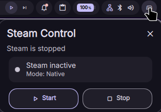

# Steam Big Picture Toggle

A Dux Shell (formerly DankMaterialShell) widget plugin to launch Steam in Big Picture mode with custom arguments, Gamescope display presets, startup/shutdown hooks, and optional automated audio routing.



## Features

- **Expressive Material 3 popout:** Clean card layout with squircle gaming badge, live status pill, and instant Settings shortcut.
- **Interactive Quick Cards:** Toggle Gamescope and Flatpak runtime directly from the popout with instant visual feedback.
- **Dynamic Hero Action:** Single full-width launch button (`Launch Big Picture`) that switches to (`Exit Big Picture`) when active.
- **Display Presets:** Select `1080p`, `1440p`, `4K`, `720p` resolution presets and target refresh rates (`60 Hz` to `240 Hz`) without typing Gamescope flags manually.
- **Configurable Audio Routing:** Optional audio routing toggle (`enableAudioRouting`) to cycle audio outputs through `dms ipc` and adjust target volume on launch.
- **Process Efficiency:** Adaptive polling (15s when closed, 3s when open, 2s during transition) with zero-overhead status checks.
- **Bounded Logging:** Logs are stored in `$XDG_CACHE_HOME/dankConsoleSteam/steam_toggle.log` with a strict 64 KiB ceiling.

## Dependencies

- `steam` (native package or Flatpak `com.valvesoftware.Steam`)
- `gamescope` (optional, for custom resolution, scaling, and gamescope features)
- `jq` (required, for parsing plugin settings)
- `pciutils` (optional, `lspci` is used as a fallback if `nvidia-smi` is unavailable)

## Installation

### Registry (Recommended)

Install directly via the Dux Shell plugin manager or CLI:

```bash
dms plugins install dankConsoleSteam
```

### Manual Install

1. Clone or download this repository:

```bash
git clone https://github.com/JessVolet/DankConsoleModeWithSteam.git
```

2. Symlink it into your Dux Shell plugins directory:

```bash
ln -sf /path/to/DankConsoleModeWithSteam "${XDG_CONFIG_HOME:-$HOME/.config}/dms/plugins/dankConsoleSteam"
```

3. Open **Dux Shell Settings → Plugins**, click **Scan for Plugins**, and enable **Steam Big Picture**.
4. Add the widget to your bar or Control Center.

## IPC Commands

Control the plugin via Dux Shell / DMS IPC:

| Command | Description |
| --- | --- |
| `dms ipc call plugins reload dankConsoleSteam` | Reload the plugin at runtime |

## Configuration

Configure options in Dux Shell Settings under **Steam Big Picture Settings**:

### Launch Mode
- **Use Flatpak**: Run Steam via Flatpak (`com.valvesoftware.Steam`) or native package.
- **Use Gamescope**: Run Steam inside the Gamescope micro-compositor.

### Gamescope & Display
- **Resolution Preset**: Select `1080p`, `1440p`, `4K`, `720p`, or `Custom (from Arguments)`.
- **Refresh Rate**: Target display refresh rate (e.g., `60 Hz`, `120 Hz`, `144 Hz`, `165 Hz`, `240 Hz`).
- **Fullscreen Mode**: Run Gamescope in fullscreen mode (`-f`).
- **NVIDIA Prime Offload**: Auto-detect NVIDIA GPU, force offload, or disable.
- **Additional Gamescope Arguments**: Custom flags passed directly to Gamescope (e.g., `-b --force-grab-cursor`).

### Audio Routing
- **Enable Audio Routing**: Enable or disable automatic audio device switching on startup.
- **Target Audio Device**: Substring of the device name (e.g., `HDMI`, `TV`, `AD107`).
- **Target Volume**: Desired volume percentage (0–100%).
- **Audio Search Attempts**: Maximum retries when cycling audio devices.

### Lifecycle Commands
- **Command on Close**: Program to run when Big Picture exits (e.g., `steam` to reopen desktop client).
- **Extra Startup / Shutdown Commands**: Command hooks executed before start and after exit (e.g., `dms ipc outputs setProfile Gaming`).
